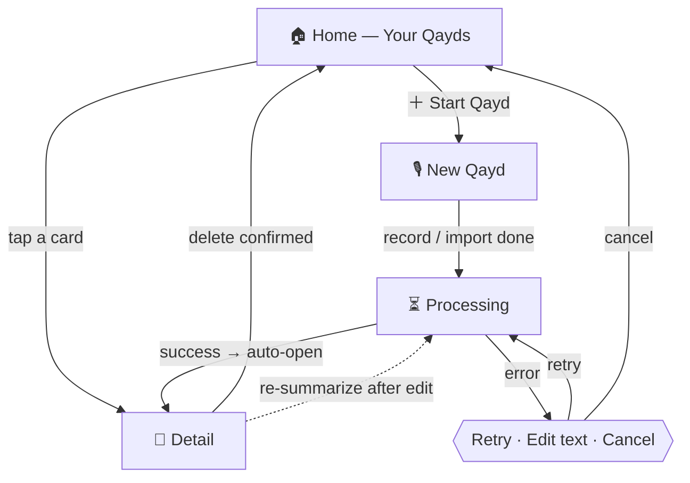
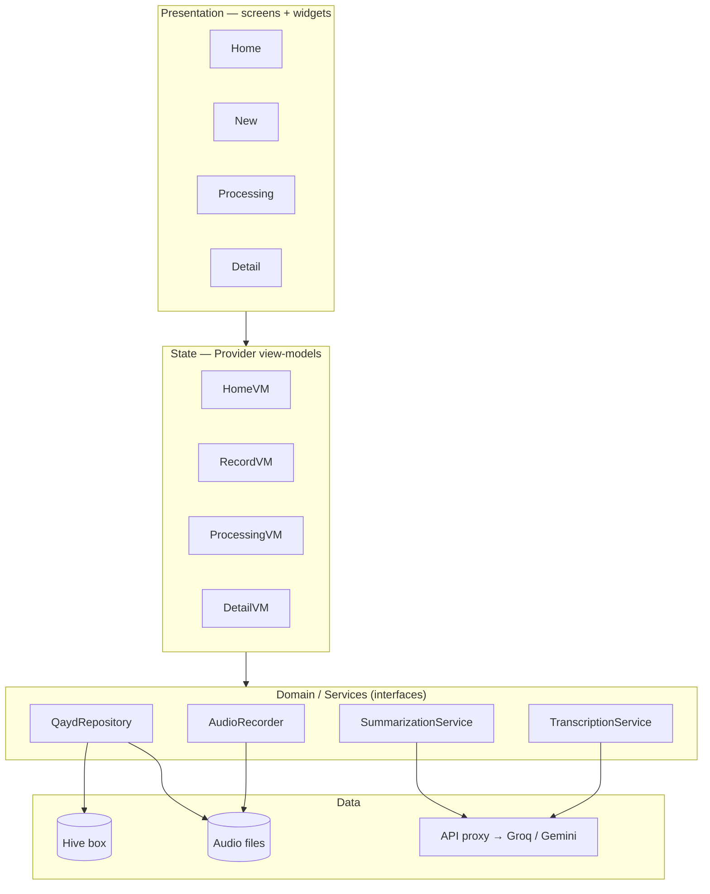
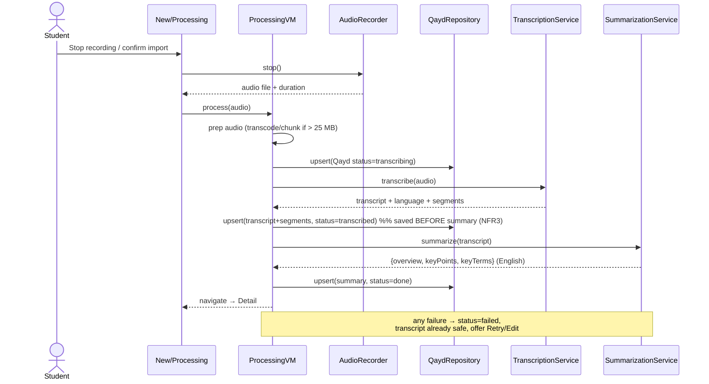
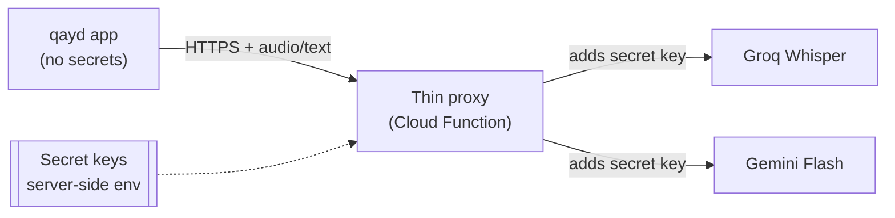

# qayd (قَيْد) — Requirements, Design & Architecture
### Developer Edition — internal working spec + build checklist

> Companion to `project_roadmap.md`. This is the detailed, buildable version: every requirement has an ID and acceptance criteria, every screen and service has a spec, and each section ends with a checklist you can tick off as you build. Scope is the locked MVP — anything not listed here is deliberately out.
>
> Legend: **[M]** must-have (MVP) · **[S]** should-have · **[C]** could-have (stretch) · ☐ = to build / ☑ = done
>
> Stack: Flutter · Groq-hosted **Whisper-large-v3** (STT) · Google **Gemini Flash** (summarization) · Hive (local storage) · Provider (state).

---

## 1. Requirements

### 1.1 Problem & product vision
Students cannot listen closely and take complete notes at the same time; important points get lost and re-writing notes afterward wastes study time. **qayd** captures a lecture (recorded live or uploaded), transcribes it, and produces a structured summary — so the fleeting "prey" of a lecture is tethered into notes the student keeps. The MVP proves one thing end-to-end: *audio in → trustworthy structured notes out*. It transcribes lectures in both Arabic and English (and code-switched speech), and distills them into clear **English** study notes.

### 1.2 Scope — LOCKED (MoSCoW)

| In scope (this version) | Priority | Out of scope (deliberately) |
|---|---|---|
| Record audio in-app | [M] | Lecture-to-lecture comparison |
| Upload/import an audio file (≤ 100 MB) | [M] | Multi-user accounts / collaboration |
| Transcribe with **timestamped segments** (Groq Whisper-large-v3) | [M] | On-device offline transcription |
| Tap a transcript line to **seek audio playback** | [M] | Real-time live transcription |
| Summarize → summary + key points + key terms, **in English** (Gemini Flash) | [M] | Cloud sync of lectures (Firebase) — future |
| View transcript + summary | [M] | Text-to-speech "podcast" summary — future |
| Save & list "Qayds" locally | [M] | Export to PDF / share — future |
| Serverless **API-key proxy** (keys off-device) | [M] | Arabic-language summaries — future |
| Rename / delete a Qayd · Edit transcript · Subject folders | [S] | Payment / sign-in accounts |
| (carried as non-functional requirements — NFR9–NFR11) | | iOS / web release — later |

### 1.3 Functional requirements

| ID | Requirement | Pri | Acceptance criteria |
|----|-------------|:---:|---------------------|
| FR1 | Record a lecture in-app (start / pause / resume / stop) with elapsed timer and a live mic-level indicator | [M] | Produces a playable local audio file; recording survives screen rotation; hard cap at 60 min |
| FR2 | Import an existing audio file (m4a / mp3 / wav), up to **100 MB** | [M] | Picked file is validated for format + size; if it exceeds Groq's 25 MB upload limit it is **transcoded to mono low-bitrate** and, if still larger, **split into ≤25 MB chunks** before upload; copied into app storage |
| FR3 | Transcribe audio via Groq Whisper-large-v3 (auto language: ar / en / mixed), returning **timestamped segments** | [M] | A 1-min clip returns a transcript in ≈30 s; both Arabic and English read correctly; each segment carries start/end seconds; chunked audio is stitched with per-chunk time offsets; failure shows a retry action |
| FR4 | Summarize the transcript via Gemini Flash into `{summary, keyPoints[], keyTerms[]}` | [M] | Summary ≤ ~200 words; ≥ 3 key points; each term has a one-line definition; the summary is **always written in English**, even when the transcript is Arabic or mixed |
| FR5 | View result on a detail screen (Transcript / Summary sections) | [M] | Text is scrollable and copyable; Arabic renders right-to-left correctly |
| FR6 | Persist each Qayd (metadata + transcript + summary + audio path) and list them newest-first on Home | [M] | Data survives an app restart; each row shows title, date, duration |
| FR7 | Bilingual UI (English / Arabic) with RTL layout | [M] | Changing device locale flips direction; no clipped or mis-aligned text |
| FR8 | Tap a transcript segment to **seek audio** to that moment; the current segment highlights during playback | [M] | Tapping a line jumps `just_audio` to its start-second; the active segment is visually marked as audio plays |

> **Note:** managing a Qayd (rename/delete), editing the transcript, and organizing into folders are carried as **non-functional requirements NFR9–NFR11** (§1.4), per the doctor's feedback.

### 1.4 Non-functional requirements

| ID | Category | Requirement |
|----|----------|-------------|
| NFR1 | Performance | UI reacts in < 1 s; every network call is async with visible progress; the main thread never blocks |
| NFR2 | Usability | ≤ 3 taps from Home to a running recording; every screen has empty / loading / error states; tap targets ≥ 48 dp |
| NFR3 | Reliability | Graceful handling of no-network, API error, timeout, denied permission; transcript is auto-saved *before* summarizing so work is never lost; retries use backoff |
| NFR4 | Security & privacy | API keys are **never** shipped in the app binary — calls go through a thin proxy; keys injected via `--dart-define` / `.env`; audio stays on-device; user can delete all data; mic permission requested with a rationale |
| NFR5 | Cost control | Recording length capped (default 60 min); use Groq + Gemini free/low tiers; no silent background calls that burn quota |
| NFR6 | Portability | Android 8+ first (release APK); code kept platform-neutral so iOS / web stay possible |
| NFR7 | Maintainability | Layered architecture; AI providers sit behind interfaces so Groq / Gemini can be swapped without touching the UI; lints on; core widget tests |
| NFR8 | Accessibility | Scalable text, sufficient contrast, semantic labels on actions |
| NFR9 | Manageability | Every saved Qayd is renameable and removable: rename persists immediately; delete requires a confirm and removes the record *and* its audio file (no orphans) |
| NFR10 | Organization | Qayds can be grouped into subject folders; a folder is created, assigned, and used to filter Home without breaking the newest-first list |
| NFR11 | Data integrity / editability | A user can correct the transcript before it is summarized; edits persist and the summary is regenerated from the edited text, never the stale one |

---

## 2. Design

### 2.1 Design principles
1. **One job per screen.** Each screen answers a single question: *What have I saved? · What am I capturing now? · Is it done yet? · What did I get?*
2. **The pipeline is the product.** Record/import → transcribe → summarize → save is the spine; every design choice serves making that flow legible and trustworthy.
3. **Never lose the user's work.** The transcript is persisted *before* summarization (NFR3), so a failed/again summary never costs the recording or transcript.
4. **Bilingual by construction.** Every string comes from a localization table; layout is direction-agnostic (`Directionality` / logical insets), so Arabic RTL is a flip, not a redesign (FR8).
5. **Honest states.** Every async surface shows empty / loading / error / success explicitly — no silent spinners, no dead ends; errors always offer the next action (NFR2, NFR3).

### 2.2 Screen map

qayd is a 4-screen app plus a lightweight settings sheet:

| # | Screen | Route | Purpose | Primary FRs |
|---|--------|-------|---------|-------------|
| S1 | **Home — "Your Qayds"** | `/` | List saved Qayds newest-first; entry point to create | FR6, NFR9, NFR10 |
| S2 | **New Qayd** | `/new` | Record live *or* import a file; name it | FR1, FR2 |
| S3 | **Processing** | `/processing` | Show transcribe → summarize progress; handle retry | FR3, FR4 |
| S4 | **Detail** | `/qayd/:id` | Read transcript + summary/key points/terms; manage | FR5, FR8, NFR9, NFR11 |
| — | Settings sheet | modal | Language, delete-all-data, about | FR8, NFR4 |

### 2.3 Navigation flow



### 2.4 Screen specifications

#### S1 · Home — "Your Qayds"
- **Purpose:** show every saved Qayd, newest first; one tap to open, one tap to start a new one.
- **Layout:** `AppBar` (title "Your Qayds", language toggle, overflow → Settings) · scrollable list of **Qayd cards** · floating **"＋ Start Qayd"** button (bottom-right / start-aligned in RTL).
- **Qayd card shows:** title · relative date (e.g. "today, 14:30") · duration badge · language chip (AR/EN/Mixed) · a status dot if still processing.
- **Card actions:** tap → Detail; long-press / trailing ⋮ → rename, delete (confirm), (later) move to folder.
- **States:** *empty* → illustration + "No Qayds yet. Tap Start Qayd to capture your first lecture." · *loading* → 3 shimmer cards · *error* (storage read) → inline retry.
- **Acceptance:** FR6 (newest-first, title/date/duration), NFR9 (rename/delete), NFR10 (folder filter), NFR2 (≤3 taps to record).

#### S2 · New Qayd
Two tabs or a segmented control: **Record** | **Import**.

*Record mode*
- Big circular **Record** button; while recording: elapsed **MM:SS** timer, animated **mic-level** meter, **Pause/Resume** and **Stop**.
- Hard cap **60:00** → auto-stop + toast (NFR5); recording continues across rotation (FR1).
- Mic permission requested with a rationale sheet *before* the first record (NFR4); denied → explain + "Open settings".

*Import mode*
- "Choose audio file" → system picker filtered to **m4a / mp3 / wav** (FR2).
- Validate container + size (reject > **100 MB** or > 60 min); invalid → clear inline message.
- Files over Groq's **25 MB** upload limit are transcoded to mono low-bitrate and, if still over, split into ≤25 MB chunks before upload — shown as a brief "Preparing audio…" step (FR2, FR3).

- **On finish (either mode):** show an editable **title** field (default "Lecture · {date}") → **Continue** copies/keeps the audio in app storage and routes to Processing.
- **States:** *idle* · *recording* · *paused* · *importing* · *invalid-file error* · *permission-denied*.
- **Acceptance:** FR1, FR2; NFR4 (permission rationale); NFR5 (cap).

#### S3 · Processing
- **Purpose:** make the wait legible and keep work safe. Two visible stages with a stepper:
  1. **Transcribing** (Groq Whisper-large-v3) — indeterminate progress + "Transcribing your lecture…"
  2. **Summarizing** (Gemini Flash) — "Writing your summary…"
- **Safety:** the moment the transcript returns it is **saved to the Qayd** (status `transcribed`) *before* the summary call starts, so a summary failure never loses the transcript (NFR3).
- **On success:** persist summary (status `done`) and auto-navigate to Detail.
- **On error:** stop the spinner and show a card with the cause + actions: **Retry** (same stage, exponential backoff), **Edit transcript** (jump to editor, S4), **Cancel** (keep what we have, go Home). Never a bare spinner (NFR3).
- **Acceptance:** FR3, FR4; NFR1 (async, visible progress), NFR3 (auto-save, graceful errors).

#### S4 · Detail
- **Header:** title (inline-editable → rename, NFR9), date · duration · language chip, overflow ⋮ (delete, re-summarize, later: move to folder).
- **Body (tabbed or sectioned):**
  - **Summary** — the ≤200-word summary (**always English**, LTR), then **Key points** (bulleted) and **Key terms** (term → one-line definition) as cards (FR4/FR5).
  - **Transcript** — full text in the lecture's own language/direction, scrollable, **copyable**, **Edit** button (NFR11); audio **play/scrub** bar (`just_audio`). Each segment is **tappable to seek** and the **current segment highlights** during playback (FR8).
- **Edit transcript (NFR11):** opens an editable text view; **Save** persists and offers **Re-summarize** → back to S3 using the edited text.
- **Mixed direction:** the English summary renders LTR while an Arabic/mixed transcript renders right-to-left — both correct on the same screen (FR7, NFR8).
- **States:** *done* · *transcript-only* (summary failed/pending) with a "Generate summary" action · *empty transcript* guard.
- **Acceptance:** FR5, FR8 (tap-to-seek), NFR9 (rename/delete), NFR11 (edit → re-summarize); (stretch) NFR10 folder assign.

#### Settings sheet
Language (System / العربية / English), **Delete all data** (double-confirm; wipes records + audio files, NFR4), About + privacy note ("audio stays on your device").

### 2.5 Visual identity

Carries the proposal's scholarly brand into the app.

| Token | Value | Use |
|-------|-------|-----|
| `primary` (teal) | `#2E7D6E` | brand, primary buttons, active states |
| `accent` (blue) | `#2E6DA4` | links, secondary actions, info |
| `danger` | `#CC3300` | delete, errors |
| `surface` / `bg` | `#FFFFFF` / `#F6F8F7` | cards / app background |
| `ink` / `muted` | `#1D2B28` / `#6B7A76` | text / secondary text |

- **Type:** a humanist serif for headings (brand nod to the proposal) + a clean sans for body/UI; scales with system font size (NFR8). Arabic uses a matching Naskh face (e.g. *Noto Naskh Arabic*) so AR/EN feel like one product.
- **Logo mark:** a stylized knot/tether (قَيْد = tether) — reused as the empty-state illustration.
- **Microcopy (brand voice):** primary CTA **"Start Qayd"**, home title **"Your Qayds"**, success toast "Qayd saved", processing "Tethering your lecture…". Full EN/AR string table lives in `theme/strings` and feeds localization.

### 2.6 Component states catalogue

Every data-bound widget must implement all four:

| Component | Empty | Loading | Error | Success |
|-----------|-------|---------|-------|---------|
| Home list | illustration + CTA | shimmer cards | retry banner | list of cards |
| Record button | "Ready" idle | pulsing + timer | permission/hw error | returns audio file |
| Processing | — | staged stepper | cause + Retry/Edit/Cancel | routes to Detail |
| Summary panel | "No summary yet" + generate | 3 skeleton lines | "Couldn't summarize" + retry | summary + points + terms |
| Transcript panel | "No transcript" | skeleton | retry | scrollable copyable text |

> Reusable widgets to build once: `QaydCard`, `EmptyState`, `LoadingShimmer`, `ErrorRetry`, `StageStepper`, `MicLevelMeter`, `AudioScrubber`, `KeyTermTile`.

### 2.7 Data model

The core entity is a **Qayd**. Stored locally in Hive (one box, `qayds`); audio lives as a file, only its path is stored.

```dart
enum QaydStatus { recording, transcribing, transcribed, summarizing, done, failed }
enum QaydLanguage { ar, en, mixed }

class KeyTerm {           // Hive typeId: 3
  final String term;
  final String definition;
}

class TranscriptSegment { // Hive typeId: 4 — powers tap-to-seek (FR8)
  final double startSec;
  final double endSec;
  final String text;
}

class Summary {           // Hive typeId: 2
  final String overview;          // ≤ ~200 words, always English (FR4)
  final List<String> keyPoints;   // ≥ 3
  final List<KeyTerm> keyTerms;
}

class Qayd {              // Hive typeId: 1
  final String id;                // uuid v4
  String title;
  final DateTime createdAt;
  int durationSec;
  String audioPath;               // local file path
  QaydLanguage language;          // of the audio/transcript
  String? transcript;             // set after FR3 (full text)
  List<TranscriptSegment> segments; // set after FR3 — timestamps
  Summary? summary;               // set after FR4 (English)
  QaydStatus status;
  String? folderId;               // [S] NFR10 (organization)
}
```

- **Why store status:** lets Home show in-progress Qayds and lets the app resume/retry a failed summary without re-transcribing.
- **Why segments:** each `{startSec, endSec, text}` lets Detail jump playback to a tapped line and highlight the current line as audio plays (FR8); for chunked uploads the offsets are shifted per chunk so timings stay continuous.
- **Why path-not-blob:** keeps the Hive box small and fast; deleting a Qayd also deletes the file at `audioPath` (NFR9).
- **Folder** (NFR10): `{ id, name, createdAt }` in a second box; `Qayd.folderId` is a soft reference.
- **Migration note:** register adapters with stable `typeId`s; add new fields as nullable (or empty-default lists) to avoid breaking existing boxes.

### 2.8 AI pipeline design

**Stage 1 — Transcription (Groq Whisper-large-v3).** Multipart `POST` of the audio file; let the model auto-detect language so code-switched (AR+EN) lectures transcribe natively.

```
POST https://api.groq.com/openai/v1/audio/transcriptions   (via our proxy)
multipart: file=<audio>, model="whisper-large-v3",
           response_format="verbose_json", temperature=0
→ { text, language, duration, segments[...] }
```
We keep `text` (the transcript), `language` (maps to `QaydLanguage`), and **`segments`** — each `{start, end, text}` is stored as a `TranscriptSegment` to power tap-to-seek and current-line highlighting on Detail (FR8). **Large files:** Groq accepts uploads up to **25 MB**; anything larger is transcoded to mono low-bitrate and, if still over, split into ≤25 MB chunks whose segment times are shifted by each chunk's offset so the stitched transcript stays continuous (FR2/FR3).

**Stage 2 — Summarization (Gemini Flash).** One call, strict-JSON output, **summary always in English** regardless of the transcript language. Prompt skeleton:

```
System: You are a study assistant. Summarize the lecture transcript.
Respond ONLY with valid JSON matching the schema. ALWAYS write the
summary, key points, and key terms in English, even when the transcript
is Arabic or mixed. Be faithful: never invent facts not in the transcript.

Schema:
{ "sourceLanguage": "ar|en|mixed",
  "overview": "string, ≤200 words, English",
  "keyPoints": ["string (English)", ...   (3–7)],
  "keyTerms": [ {"term":"string","definition":"string ≤1 line, English"}, ... ] }

Transcript: """{{transcript}}"""
```

- **Robust parsing:** request JSON mime type where supported; otherwise strip code fences and `jsonDecode`; on malformed JSON → one reformat retry, then surface a clean error (NFR3).
- **Long transcripts:** if a transcript exceeds the model window, chunk by paragraphs, summarize chunks, then summarize the summaries (map-reduce). MVP target (≤60-min lecture) usually fits one call.
- **Language handling:** Stage 1 detects the audio language (sets `Qayd.language` / transcript direction, RTL for `ar`); Stage 2 **always emits English** so study notes are uniform. The UI chrome stays bilingual (FR8); only the AI-generated summary content is English-only this version.

### 2.9 Error & edge-case matrix

| Case | Where | Behaviour |
|------|-------|-----------|
| Mic permission denied | S2 | Rationale sheet → "Open settings"; never crash |
| No / dropped network | S3 | "You're offline — we'll retry." Retry with backoff; transcript kept |
| Groq/Gemini API error or 429 | S3 | Show cause; exponential backoff (e.g. 1s→2s→4s, max 3); then manual Retry |
| Timeout (slow upload) | S3 | Cancelable; partial upload discarded; retry |
| Empty / silent audio | S3 | Transcript empty → "No speech detected"; offer re-record |
| Audio over 25 MB (Groq cap) | S2/S3 | Auto-transcode to mono low-bitrate; if still > 25 MB, split into chunks and stitch segments by offset |
| Audio too long / too large | S2 | Over **100 MB** or **60 min** blocked at import/cap with a clear message (NFR5) |
| Malformed summary JSON | S3 | One reformat retry → else keep transcript, show "summary failed" |
| App killed mid-pipeline | — | On relaunch, Qayd shows its last `status`; user can resume/retry |
| Storage full on save | S2/S3 | Fail gracefully, keep in-memory data, prompt to free space |

### ☐ Section 2 — Design checklist
- ☐ Build reusable widgets: `QaydCard`, `EmptyState`, `LoadingShimmer`, `ErrorRetry`, `StageStepper`, `MicLevelMeter`, `AudioScrubber`, `KeyTermTile`
- ☐ S1 Home: list newest-first, card (title/date/duration/lang), rename + delete, empty/loading states (FR6, NFR9, NFR10)
- ☐ S2 New Qayd: record (timer, level, pause/resume, 60-min cap, rotation-safe) + import (format/size validation, ≤100 MB) + title entry (FR1, FR2)
- ☐ Audio prep: transcode to mono low-bitrate + chunk > 25 MB with per-chunk time offsets (Groq limit) (FR2/FR3)
- ☐ S3 Processing: two-stage stepper, transcript saved before summary, Retry/Edit/Cancel on error (FR3, FR4)
- ☐ S4 Detail: Summary (English overview + key points + terms) & Transcript (copyable, tap-to-seek + highlight, edit→re-summarize), audio playback, rename/delete, RTL transcript correct (FR5, FR8, NFR9, NFR11)
- ☐ Settings sheet: language, delete-all-data, privacy note
- ☐ Apply visual tokens + EN/AR string table; verify RTL on every screen
- ☐ Implement the error matrix behaviours

---

## 3. Architecture

### 3.1 Architectural style
**Layered + MVVM-lite + Repository.** Four layers, dependencies point downward only:

**Presentation** (screens/widgets) → **State** (Provider ChangeNotifiers = view-models) → **Services/Domain** (behind interfaces) → **Data** (Hive, file system, proxy/network).

Rationale: a 2-person team can split cleanly along this seam (Wasel owns Presentation+State, Halim owns Services+Data), AI vendors sit behind interfaces so Groq/Gemini can be swapped without touching the UI (NFR7), and the UI never imports `dio`/Hive directly.

### 3.2 Layer diagram



### 3.3 Module responsibilities

| Module | Responsibility | Key deps |
|--------|----------------|----------|
| `screens/` | Render UI, dispatch user intent to view-models; zero business logic | Flutter, state |
| `state/` | Hold screen state, orchestrate the pipeline, expose `notifyListeners` | services |
| `services/audio/` | Record (start/pause/resume/stop), mic level, playback | `record`, `just_audio` |
| `services/ai/` | `TranscriptionService` (Groq), `SummarizationService` (Gemini) behind interfaces | `dio` |
| `data/` | `QaydRepository` CRUD over Hive + audio-file lifecycle | `hive`, `path_provider` |
| `core/` | Config, DI wiring, result/error types, localization, theme | — |

### 3.4 Service interfaces (swap-friendly seams)

The UI/state depend on these abstractions, never on a concrete vendor (NFR7). Swapping Groq→ElevenLabs or Gemini→another LLM means writing one new implementation and changing one line of DI.

```dart
abstract class AudioRecorder {
  Future<void> start();
  Future<void> pause();
  Future<void> resume();
  Future<RecordResult> stop();        // → { path, durationSec }
  Stream<double> amplitude();         // mic-level meter 0..1
}

abstract class TranscriptionService {
  /// Uploads audio, returns transcript + detected language + timestamped segments.
  Future<Transcript> transcribe(File audio, {CancelToken? cancel});
  // Transcript = { text, QaydLanguage language, List<TranscriptSegment> segments }
}

abstract class SummarizationService {
  /// Transcript → structured summary (overview/keyPoints/keyTerms), always in English.
  Future<Summary> summarize(String transcript, {CancelToken? cancel});
}

abstract class QaydRepository {
  Future<List<Qayd>> listNewestFirst();
  Future<Qayd?> getById(String id);
  Future<void> upsert(Qayd q);
  Future<void> delete(String id);     // also deletes audio file
}
```

Concrete MVP implementations: `GroqTranscriptionService`, `GeminiSummarizationService`, `RecordAudioRecorder`, `HiveQaydRepository`. All network calls return a typed `Result`/throw a typed `AppException` so the state layer can map errors to the matrix in §2.9.

### 3.5 Sequence — record → transcribe → summarize → save



### 3.6 Folder structure

```
lib/
  main.dart            # bootstrap: init Hive, register adapters, wire DI, runApp
  core/
    config.dart        # reads API base URL / keys from --dart-define / .env
    di.dart            # provider wiring (interface → concrete impl)
    result.dart        # Result<T> / AppException types
    l10n/              # en + ar string tables (FR8)
    theme/             # colors, typography, brand microcopy
  models/              # qayd.dart, summary.dart, key_term.dart (+ .g.dart adapters)
  services/
    audio/             # record_audio_recorder.dart, player.dart
    ai/                # transcription_service.dart (+ groq impl),
                       # summarization_service.dart (+ gemini impl)
  data/                # qayd_repository.dart (+ hive impl), paths.dart
  state/               # home_vm.dart, record_vm.dart, processing_vm.dart, detail_vm.dart
  screens/             # home/, new_qayd/, processing/, detail/
  widgets/             # qayd_card, empty_state, loading_shimmer, error_retry, ...
```

### 3.7 State management (Provider)

One `ChangeNotifier` view-model per screen, provided at app root; screens `watch` state and `read` methods.

| View-model | Owns | Exposes |
|------------|------|---------|
| `HomeVM` | list of Qayds, load/empty/error | `qayds`, `refresh()`, `rename()`, `delete()` |
| `RecordVM` | recorder state, timer, level, cap | `start/pause/resume/stop()`, `pickFile()` |
| `ProcessingVM` | pipeline stage + errors | `process(audio)`, `retry()`, `cancel()` |
| `DetailVM` | one Qayd, edit/re-summarize | `qayd`, `saveTranscript()`, `resummarize()` |

Keep view-models free of Flutter widget imports (testable in pure Dart). DI (`core/di.dart`) injects service interfaces so tests pass fakes.

### 3.8 Security architecture (NFR4)

**Keys must never ship in the APK.** Direct client→vendor calls would embed the secret in the binary where it can be extracted. Design:



- **Delivered design (the secure option):** the **serverless proxy is part of the MVP**, stood up in Week 1 so every build — including the demo — calls vendors through it and the APK never contains a key. Each service's `baseUrl` points at the proxy.
- **Dev fallback (local only):** to unblock a developer before the proxy is live, the same interface can target vendors directly with a key from `--dart-define`/`.env`. This is a *local-only convenience*, never used for any shared or submitted build — flipping back is one config line, no code change.
- **Never commit secrets:** `.env` is in `.gitignore`; keys live only in the proxy's server-side environment (or a developer's local `--dart-define`).
- **On-device privacy:** audio and transcripts stay local in app storage; audio transits the proxy to the STT API only for transcription and is **never persisted server-side**; **Delete all data** removes records + audio files; mic permission is requested with a rationale.
- **Transport:** HTTPS only; no analytics/telemetry on lecture content; no silent background calls (NFR5).

### 3.9 Architecture decisions (ADR-lite)

| # | Decision | Why | Trade-off / revisit if |
|---|----------|-----|------------------------|
| A1 | **Two-stage pipeline** (Whisper STT → Gemini summarize) | Showcases both skills; each stage swappable; best accuracy control | 1 extra call vs. Gemini-audio-direct → *fallback if Groq integration stalls* |
| A2 | **Groq Whisper-large-v3** for STT | Cheapest capable AR+EN option; fast | Code-switch accuracy < ElevenLabs Scribe → *upgrade behind the interface later* |
| A3 | **Gemini Flash** for summaries, **English-only output** | Cheap, fast, JSON output; one consistent study-note language keeps the UI simple and avoids weak Arabic generation | No native-Arabic summaries this version → revisit if users ask for AR summaries (prompt/model bump) |
| A4 | **Provider** for state | Simplest for a 2-person MVP; low ceremony | Riverpod if DI/testing grows |
| A5 | **Hive** for storage | Offline-first, fast, no SQL boilerplate | sqflite if we need relational queries/folders at scale |
| A6 | **Interfaces around AI + storage** | Vendor-swap without UI changes (NFR7); testable | small upfront boilerplate |
| A7 | **Serverless proxy for keys** (delivered, Week 1) | Keys never in binary (NFR4); demo runs on the secure path | one small Cloud Function to maintain; local dev-key fallback is config-only |
| A8 | **Save transcript before summarizing** | Never lose work (NFR3) | one extra write |
| A9 | **Timestamped segments in MVP** | Enables tap-to-seek + current-line highlight (FR8); low marginal cost (Whisper already returns them) | slightly larger Hive records |

### 3.10 Deployment view
- **Target:** Android 8+ release **APK** first; code kept platform-neutral so iOS/web remain possible (NFR6).
- **Build-time config:** `--dart-define=API_BASE_URL=…` points at the proxy; `.env` git-ignored.
- **Key proxy (delivered):** a single Cloud Function holds the vendor keys; all builds point at it (stood up Week 1).
- **Artifacts:** signed APK, source repo, short README + user guide (Week 5).

### ☐ Section 3 — Architecture checklist
- ☐ Create the `lib/` layer folders; enforce downward-only dependencies
- ☐ Define interfaces: `AudioRecorder`, `TranscriptionService`, `SummarizationService`, `QaydRepository`
- ☐ Implement `GroqTranscriptionService`, `GeminiSummarizationService`, `RecordAudioRecorder`, `HiveQaydRepository`
- ☐ Wire DI in `core/di.dart`; keep view-models widget-free
- ☐ `core/config.dart` reads base URL/keys from `--dart-define`/`.env`; add `.env` to `.gitignore`
- ☐ Implement typed `Result`/`AppException`; map to §2.9 matrix
- ☐ Register Hive adapters with stable typeIds; init in `main.dart`
- ☐ Stand up the key **proxy in Week 1** and point `baseUrl` at it (keys off-device from day one)

---

## 4. Build checklist (by week)

Mirrors `project_roadmap.md`; each item ties to an FR/NFR. Tick as you go.

### Week 1 (Oct 9–15) — Requirements, Design & skeleton
- ☐ Lock requirements + scope (this doc) ✔ and share the PoC with the doctor
- ☐ Create Groq + Gemini API keys; set up `.env` + `.gitignore`; init git
- ☐ **Stand up the serverless key proxy** (Cloud Function) and point the app `baseUrl` at it (NFR4)
- ☐ Clean scaffold; create `lib/` layer folders; add deps (`provider`, `record`, `file_picker`, `just_audio`, `dio`, `hive`, `hive_flutter`, `path_provider`, `uuid`)
- ☐ Empty navigation shell across the 4 screens (NFR2)
- ☐ Define models + Hive adapters (incl. `TranscriptSegment`); theme tokens + EN/AR string tables
- **Milestone:** app launches on a device and navigates between empty screens

### Week 2 (Oct 16–22) — Audio → Transcript
- ☐ Record screen: start/pause/resume/stop, timer, mic-level, 60-min cap, rotation-safe (FR1)
- ☐ Import path: picker + format/size validation (≤100 MB); copy into app storage (FR2)
- ☐ Audio prep: transcode to mono low-bitrate + chunk > 25 MB with per-chunk offsets (FR2/FR3)
- ☐ `GroqTranscriptionService` via proxy/`dio`; keep **timestamped segments**; cancel + backoff (FR3, NFR3)
- ☐ Processing screen stage 1; save audio + transcript + segments (status `transcribed`) (NFR3)
- **Milestone:** record/import → accurate transcript on screen

### Week 3 (Oct 23–29) — Summary & persistence
- ☐ `GeminiSummarizationService`: English-only prompt, strict-JSON parse, reformat-retry (FR4)
- ☐ Processing stage 2 → save summary (status `done`) → auto-open Detail
- ☐ Detail screen: Summary (overview/points/terms) + Transcript (copyable, **tap-to-seek + highlight**) + playback (FR5, FR8)
- ☐ `HiveQaydRepository` CRUD; Home lists newest-first; open/rename/delete (FR6, NFR9)
- **Milestone:** full core flow; Qayds persist across restarts (MVP feature-complete)

### Week 4 (Oct 30–Nov 5) — Testing & hardening
- ☐ Implement full error matrix (§2.9); no-network/API/permission/empty-audio (NFR3)
- ☐ Test real lectures AR + EN, short + long; tune prompt + chunking
- ☐ Widget tests (Home card, states) + VM unit tests with fakes; manual test plan
- ☐ RTL pass (FR8); accessibility pass — text scale, contrast, semantics (NFR8)
- ☐ Transcript edit → re-summarize (NFR11); then the chosen stretch: **folders (NFR10)**
- **Milestone:** stable, tested app; no known crashes in core flow

### Week 5 (Nov 6–13) — Deployment & finalization
- ☐ App icon + splash; final polish; branding microcopy pass
- ☐ Build signed release APK; confirm it runs through the key proxy (no keys in binary)
- ☐ README + short user guide; final report, screenshots, demo video; rehearse
- **Milestone:** submitted + demo-ready

---

## 5. Open questions, assumptions & risks

### 5.1 Assumptions
- Lectures are ≤ 60 min, reasonably clear audio, one primary speaker (students recording a class).
- Device is online during the transcribe/summarize step (offline STT is explicitly out of scope).
- Groq + Gemini free/low tiers are sufficient for development and demo volume.
- Study-note summaries are written in **English** for every lecture; the app UI itself stays bilingual (EN/AR).

### 5.2 Resolved decisions (closed in Week 1)
These were the open questions; the team's answers are now locked into the design above.

| # | Question | Decision |
|---|----------|----------|
| D1 | Proxy during the course, or dev-key builds? | **Stand up the serverless proxy in Week 1** — it is the delivered secure design; every shared/demo build runs through it. A local dev-key fallback stays config-only (§3.8, A7, Week 1). |
| D2 | Keep timestamped segments, or drop for MVP? | **Keep in the MVP** — stored as `TranscriptSegment`s to power tap-to-seek + current-line highlight on Detail (FR8, A9, §2.7/§2.8). |
| D3 | Organize vs. edit — which carry as stretch? | **Folders** (NFR10) and **transcript edit** (NFR11) are the should-have capabilities; both are carried as NFRs per the doctor's feedback, after the core (FR1–FR8) is stable. |
| D4 | Max import size/length? | **100 MB / 60 min** app cap confirmed; because Groq accepts only **25 MB** uploads, larger audio is transcoded to mono low-bitrate and chunked (FR2/FR3, §2.8). |
| D5 | Arabic summary quality from Gemini Flash? | Sidestepped for this version — **summaries are always English** (FR4, A3), so weak Arabic generation is not on the critical path; native-Arabic summaries are a future item. |

### 5.3 Top risks (see roadmap §8 for the full table)
| Risk | Mitigation |
|------|-----------|
| Only 5 weeks / late start | Strict weekly milestones; cut stretch first; demoable increment each week |
| Whisper accuracy on long/Arabic audio | Test early; chunk long audio; NFR11 manual transcript edit as the safety net |
| API keys exposed | Keys out of git; interface-based services; **proxy stood up in Week 1** so no build ships a key (NFR4) |
| Scope creep | Scope is LOCKED (§1.2); stretch gated on a stable core |
| 2-person bandwidth | Clear layer ownership (Wasel = UI/state, Halim = services/data); pair-review commits |

### 5.4 Requirements traceability (quick map)
`FR1/FR2 → S2` · `FR3/FR4 → S3 + services/ai` · `FR5/FR8 → S4` · `FR6 → S1 + data` · `NFR9/NFR10 → S1 + data (manage/organize)` · `NFR11 → S4 (edit → re-summarize)` · `FR7/NFR8 → l10n/theme + every screen` · `NFR3 → §3.5 save-before-summarize` · `NFR4 → §3.8 security`.

### ☐ Section 5 — sign-off checklist
- ☐ Assumptions still hold at build time
- ☐ Each open question answered and recorded
- ☐ Scope unchanged (or change logged with the team before building)

---

*End of Developer Edition. Companion: `project_roadmap.md` (schedule) and the doctor's PoC PDF (`qayd_design_proof_of_concept.pdf`).*
